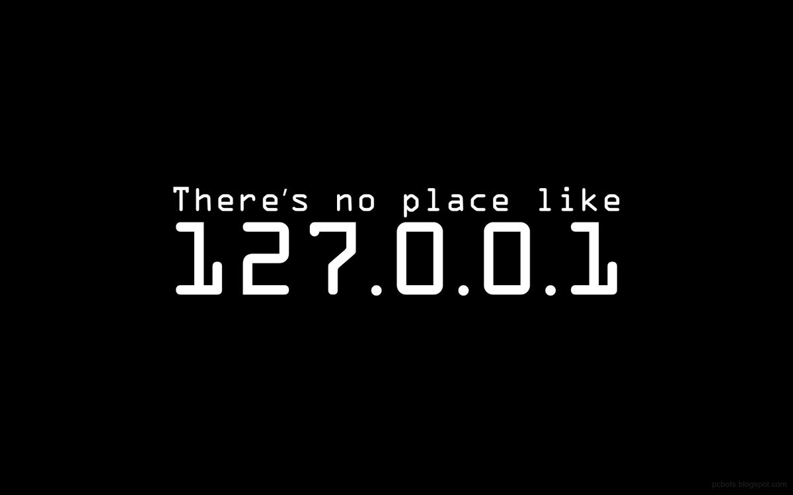
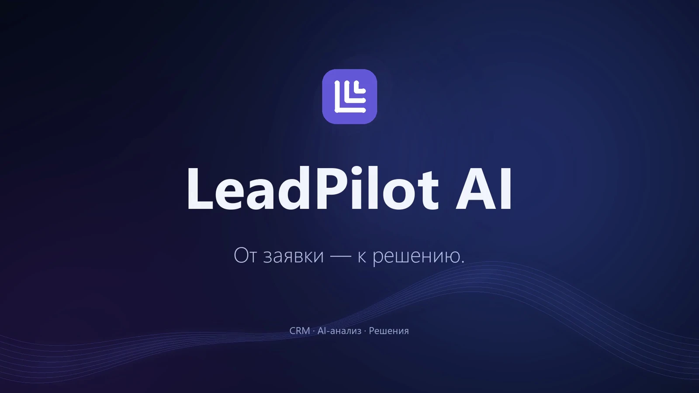
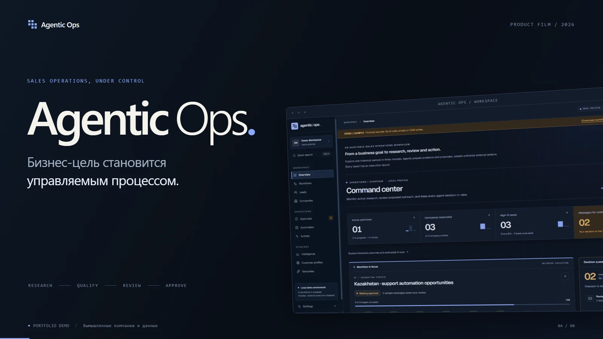
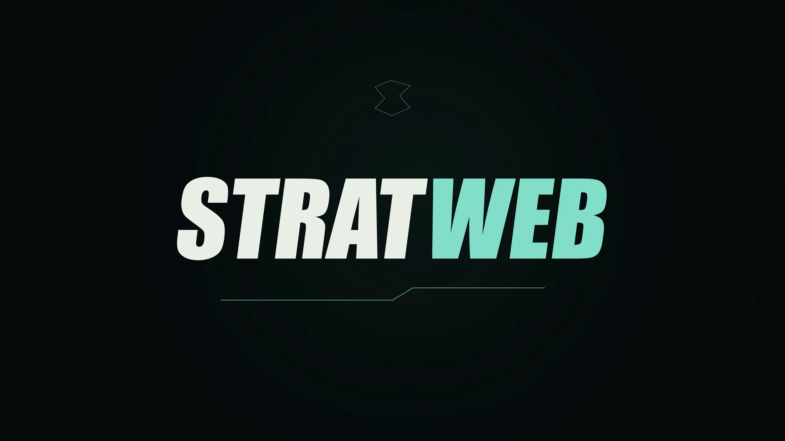

# Toksoz Sultan

  

<em>
I turn complex, broken operational workflows into working software. 
Most people stop at a mockup or an isolated API endpoint. I care about the entire loop: domain modeling, database schemas, background queues, deterministic state machines, human-in-the-loop AI agents, automated tests, and what happens when real users hit production. 
From automating 100–200 regulated documents a day for ~2,000 employees in production to building autonomous triage and tactical telemetry engines — one system at a time. 
If there is one rule I build by, it’s this: AI accelerates execution, but engineering discipline owns the architecture, edge cases, and verification. 
Understand the problem. Design the system. Ship it to production.
</em>

**[toksoz-sultan-portf.vercel.app →](https://toksoz-sultan-portf.vercel.app/)**

---

## Now

production systems & automation 
﹂**Full-Stack & Automation Engineer @ KazEcoFood (in production)** 
&nbsp;&nbsp;&nbsp;&nbsp;﹂sole engineer owning full-stack architecture, database schema, RBAC, and document generation 
&nbsp;&nbsp;&nbsp;&nbsp;﹂scaled daily throughput from **20–25 to 100–200 documents/day** (4–8× output increase) 
&nbsp;&nbsp;&nbsp;&nbsp;﹂covering **~2,000 employees** across 13 regulated workplace certification document types 
&nbsp;&nbsp;&nbsp;&nbsp;﹂backed by **70+ automated business-rule tests** in production

ai & product engineering 
﹂**Building [Agentic Ops](https://github.com/h1ziix/Agentic-Ops) & [LeadPilot AI](https://toksoz-sultan-portf.vercel.app/work/leadpilot-ai)** 
&nbsp;&nbsp;&nbsp;&nbsp;﹂human-in-the-loop AI operations platform with confidence gates, audit trails, and safe execution (`FastAPI · SQLAlchemy 2.0 · Next.js · PostgreSQL`) 
&nbsp;&nbsp;&nbsp;&nbsp;﹂end-to-end B2B lead pipeline with async BullMQ/Redis AI scoring, idempotent retries, and Zod schema validation (`Next.js 14 · NestJS · Prisma`) 
﹂**Creator of [StratWeb](https://github.com/h1ziix/StratWeb)**: evidence-first CS2 `.dem` tactical analytics & opponent scouting platform 
&nbsp;&nbsp;&nbsp;&nbsp;﹂reconstructs raw match binaries into spatial/economic patterns, reproducible findings, and counter-strategies (`Python · FastAPI · PostgreSQL · Redis`) 
﹂**Creator of [ATU Campus](https://toksoz-sultan-portf.vercel.app/work/atu-campus)**: interactive 3D/2D campus navigation & live schedule platform for Almaty Technological University

**Open to roles & contracts**: Full-Stack / Backend / AI Product Engineering (Almaty or Remote · UTC+5). [Portfolio](https://toksoz-sultan-portf.vercel.app/) · Telegram [@conf1denc](https://t.me/conf1denc) · [toksozzsultan@icloud.com](mailto:toksozzsultan@icloud.com)

---

## Product Films & Case Studies

Architecture breakdowns, interactive demos, and narrated product trailers across my flagship systems:

<table>
  <tr>
    <td width="33%" valign="top">
      
    </td>
    <td width="33%" valign="top">
      
    </td>
    <td width="33%" valign="top">
      
    </td>
  </tr>
  <tr>
    <td align="center"><b>LeadPilot AI</b> CRM · BullMQ AI Pipeline · NestJS + Next.js</td>
    <td align="center"><b>Agentic Ops</b> Human-in-the-Loop AI Triage · FastAPI + PG</td>
    <td align="center"><b>StratWeb</b> CS2 <code>.dem</code> Telemetry & Scouting · Python</td>
  </tr>
</table>

---

## Projects & Open Source

<table>
  <tr>
    <td width="50%" valign="top">
      <a href="https://github.com/h1ziix/Agentic-Ops"><b>Agentic-Ops</b></a> 
      Human-in-the-loop AI triage & incident operations · <a href="https://toksoz-sultan-portf.vercel.app/work/agentic-ops">case study</a> 
       
      
      
    </td>
    <td width="50%" valign="top">
      <a href="https://toksoz-sultan-portf.vercel.app/work/leadpilot-ai"><b>LeadPilot AI</b></a> 
      Full-stack B2B CRM with async BullMQ AI lead scoring & briefs · <a href="https://toksoz-sultan-portf.vercel.app/work/leadpilot-ai">case study</a> 
       
      
      
    </td>
  </tr>
  <tr>
    <td width="50%" valign="top">
      <a href="https://github.com/h1ziix/StratWeb"><b>StratWeb</b></a> 
      Evidence-first CS2 <code>.dem</code> tactical analytics & scouting platform · <a href="https://toksoz-sultan-portf.vercel.app/work/stratweb">case study</a> 
       
      
      
    </td>
    <td width="50%" valign="top">
      <a href="https://toksoz-sultan-portf.vercel.app/work/atu-campus"><b>ATU Campus</b></a> 
      Interactive 3D/2D university campus map, schedule & RBAC system · <a href="https://toksoz-sultan-portf.vercel.app/work/atu-campus">case study</a> 
       
      
      
    </td>
  </tr>
  <tr>
    <td width="50%" valign="top">
      <a href="https://github.com/h1ziix/KazFoodV2"><b>KazEcoFood Platform</b></a> 
      Regulated workplace certification & document automation in production 
       
      
      
    </td>
    <td width="50%" valign="top">
      <a href="https://github.com/h1ziix/CampusForge"><b>CampusForge</b></a> 
      AI-assisted workspace for structured notes, documents & academic workflows 
       
      
      
    </td>
  </tr>
</table>

Repositories & commercial builds: <a href="https://github.com/h1ziix/my_portfolio">my_portfolio</a>, <a href="https://github.com/h1ziix/Agentic-Ops">Agentic-Ops</a>, <a href="https://github.com/h1ziix/StratWeb">StratWeb</a>, <a href="https://github.com/h1ziix/KazFoodV2">KazFoodV2</a>, <a href="https://github.com/h1ziix/CampusForge">CampusForge</a>, <a href="https://github.com/h1ziix/gold_palast.kz.github.io">gold_palast.kz</a> 
Resumes: <a href="https://toksoz-sultan-portf.vercel.app/resume/toksoz-sultan-resume.pdf">English Resume (PDF)</a> · <a href="https://toksoz-sultan-portf.vercel.app/resume/toksoz-sultan-resume-ru.pdf">Russian Resume (PDF)</a>

---

## Highlights

| Highlight | Detail |
|---|---|
| **Production Impact (`KazEcoFood`)** | Sole engineer who designed, tested, and shipped an internal certification & document platform covering **~2,000 employees**, accelerating output from **20–25 to 100–200 docs/day** across 13 regulated document types |
| **Human-in-the-Loop AI Systems** | Built [Agentic Ops](https://github.com/h1ziix/Agentic-Ops) & [LeadPilot AI](https://toksoz-sultan-portf.vercel.app/work/leadpilot-ai) with structured LLM outputs (`Zod` / `Pydantic v2`), confidence thresholds, approval gates, BullMQ retry queues, and full audit logs |
| **Tactical Telemetry & Data Engineering** | Built [StratWeb](https://github.com/h1ziix/StratWeb) — parses binary CS2 `.dem` replays into tick-aligned Postgres/DuckDB models to surface repeatable team patterns and evidence-backed counter-strategies |
| **Interactive 3D/2D Campus Platform** | Built [ATU Campus](https://toksoz-sultan-portf.vercel.app/work/atu-campus) for Almaty Technological University — custom floor plans, 3D building navigation (`Three.js`), live schedules, RBAC (`Student / Teacher / Admin`), and 70+ automated tests |
| **Core Engineering Stack** | **Frontend:** `TypeScript`, `React`, `Next.js 14`, `Tailwind CSS`, `Radix/shadcn`, `TanStack Query`, `Zustand`, `RHF + Zod` **Backend & Data:** `Node.js`, `NestJS`, `Python`, `FastAPI`, `SQLAlchemy 2.0`, `Prisma`, `PostgreSQL`, `Redis`, `BullMQ`, `Docker`, `Playwright`, `Pytest` |
| **AI-Native Engineering Workflow** | Specification-first system design combined with multi-agent development (`Claude Code`, `Codex`, `Cursor`), gated by strict type-checking, schema validation, and automated E2E/integration test suites |

---

  

---

  <a href="https://toksoz-sultan-portf.vercel.app/">Portfolio</a> ·
  <a href="https://t.me/conf1denc">Telegram</a> ·
  <a href="mailto:toksozzsultan@icloud.com">Email</a> ·
  <a href="https://toksoz-sultan-portf.vercel.app/resume/toksoz-sultan-resume.pdf">Resume (EN)</a> ·
  <a href="https://toksoz-sultan-portf.vercel.app/resume/toksoz-sultan-resume-ru.pdf">Resume (RU)</a>

---
